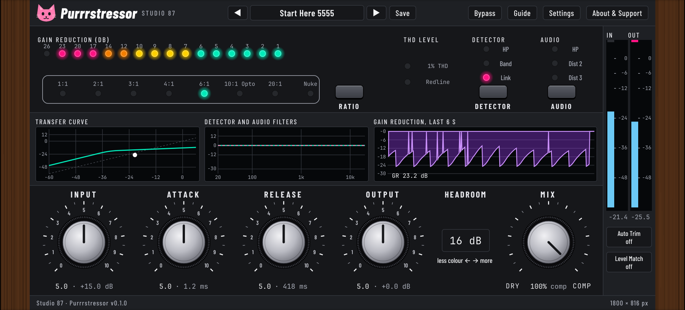

# Purrrstressor

A free, open source, cat-themed compressor plugin (VST3) inspired by the behaviour of the Empirical Labs Distressor. Our own DSP, written from the public manuals.

<p align="center"></p>
<p align="center"><sub>The real plugin window (look C), rendered offscreen by the build tools.</sub></p>

Status: test builds. DSP core, native editor and presets are in; still to do: tests in real hosts, installers and the manual.

## What it does

- Ratios 1:1, 2:1, 3:1, 4:1, 6:1, 10:1 (Opto), 20:1 and Nuke, each with its own knee
- Detector: high-pass (100 Hz), band emphasis (about 6 kHz), stereo link
- Audio: 18 dB/oct Bessel high-pass, Dist 2 (2nd harmonic), Dist 3 (3rd harmonic)
- Input, Attack (50 us to 30 ms), Release (50 ms to 3.5 s), Output, Headroom, Mix
- Auto Trim (never lets the output reach 0 dB) and Level Match (fair loudness comparison)
- Detector tap option: after Input (stable, default) or after the distortion, like the hardware diagram
- Bypass that keeps the gain reduction meter moving, 14 factory presets, your own presets as files
- Three colour looks, info bubbles, resizable window (drag any edge, double-click the wood to reset)

## Manual

[Manual (PDF)](https://github.com/SpeakingColors/Purrrstressor/blob/main/docs/Purrrstressor-manual.pdf) with a numbered tour of every control. The web page is `docs/index.html` (enable GitHub Pages from `/docs` to host it).

## Build

```
cmake -S . -B build -DCMAKE_BUILD_TYPE=Release
cmake --build build --config Release
```

Core tests (no JUCE needed): `sh tests/run.sh`

Render the real window offscreen (Linux, needs xvfb):

```
cmake -S . -B build -DPURR_BUILD_SNAPSHOT=ON && cmake --build build --target PurrrSnapshot
xvfb-run -a build/PurrrSnapshot_artefacts/Release/PurrrSnapshot window.png 1.0 C none 366
xvfb-run -a build/PurrrSnapshot_artefacts/Release/PurrrSnapshot --selftest
```

`tools/dump_layout.py` and `tools/gen_layout.py` read the approved mockup page and generate `src/editor/Layout.h`, so the window follows the mockup.

## Privacy

Collects nothing. No network access.

## Licence

AGPL-3.0-or-later (JUCE is used under AGPLv3).
